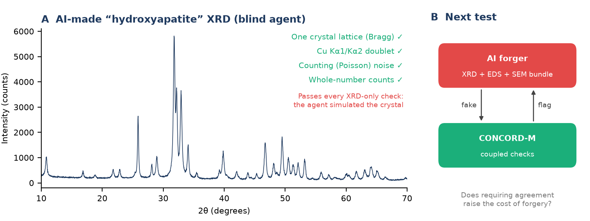

# CONCORD-M

**Cross-technique consistency for materials data: pilot code**

Can physical consistency across X-ray diffraction (XRD), energy-dispersive X-ray spectroscopy (EDS) and scanning
electron microscopy (SEM) make scientific data harder to forge? This repository holds the first pilot (working name
*checkMATE*) behind a proposed NSF EAGER concept in the Research on Research Security program. The project is
**proposed, not funded**.



## Status

Early pilot. Four XRD-only rules are implemented and tested. EDS, SEM and cross-technique rules, and the controlled
forgery-cost experiment, are planned.

## Pilot result

| Pattern | R1 one lattice (Bragg) | R2 Cu Kα1/Kα2 doublet | R3 counting noise | R4 whole-number counts |
|---|---|---|---|---|
| Physics-simulated control | PASS | PASS | PASS | PASS |
| Blind AI forgery | PASS | PASS | PASS | PASS |

An AI agent, asked only for "a realistic hydroxyapatite XRD pattern", simulated the crystal from atomic positions and
passed every XRD-only rule. Single-technique checks can therefore be beaten. The open question, and the planned
experiment, is whether requiring XRD, EDS and SEM to agree for the same sample makes forgery measurably more costly.

The tests (`tests/`) also show that the rules raise **no false flags** on physically correct patterns from 8 to 100 nm
crystallite size, and that they **do flag** simple naive fakes (constant noise, decimal counts, off-lattice peaks).

## Rules

| Rule | Physics |
|---|---|
| R1 | Resolved peaks must be explained by one hexagonal P6₃/m lattice (Bragg's law). Broad, overlapping patterns return N/A. |
| R2 | Laboratory Cu Kα data carry a Kα2 component (about half of Kα1) at a fixed wavelength offset. |
| R3 | Detector noise grows as the square root of intensity (Poisson counting). |
| R4 | Raw detector counts are whole numbers. |

## What a result means

Each rule returns **PASS**, **FLAG** (physical inconsistency, with evidence) or **N/A** (not checkable with the data
given). A flag is a reason for human review, **not** evidence of misconduct. A pass shows consistency within the
tested scope; authenticity also needs provenance.

## Run it

```bash
pip install -r requirements.txt
python scripts/run_pilot.py      # writes results/pilot_results.json
python scripts/make_figure.py    # writes figures/pilot_ai_forgery.png
python -m pytest -q
```

## Data

- `data/ai_forgery_hydroxyapatite_xrd.csv`: synthetic pattern made by a blind AI agent (the agent's generator script
  is not published, to avoid releasing a ready-made forgery tool).
- `data/physics_control_hydroxyapatite_xrd.csv`: synthetic, physically consistent control.

This repository contains **no human-derived or real measurement data**. The same files are on Hugging Face:
[masaghiri/concord-m-pilot](https://huggingface.co/datasets/masaghiri/concord-m-pilot).

## Author and license

M. Ali Saghiri ([masaghiri.github.io](https://masaghiri.github.io)). Code and data under the MIT License; see
`CITATION.cff` to cite.
